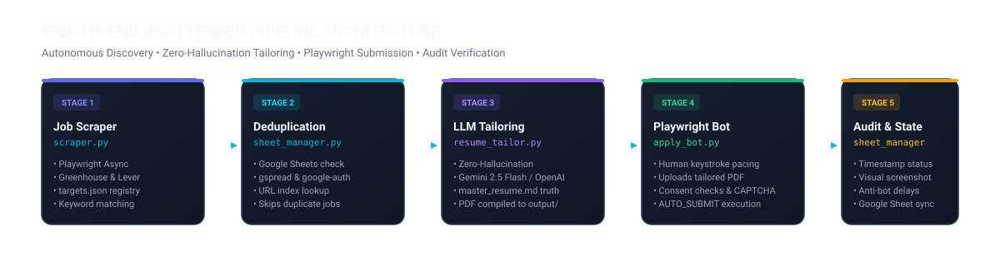
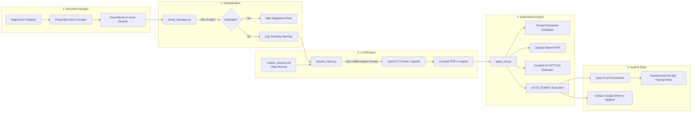
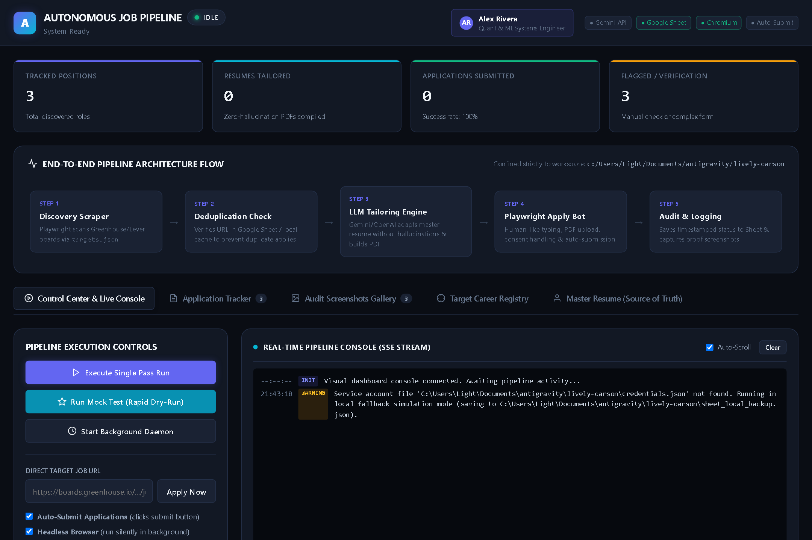
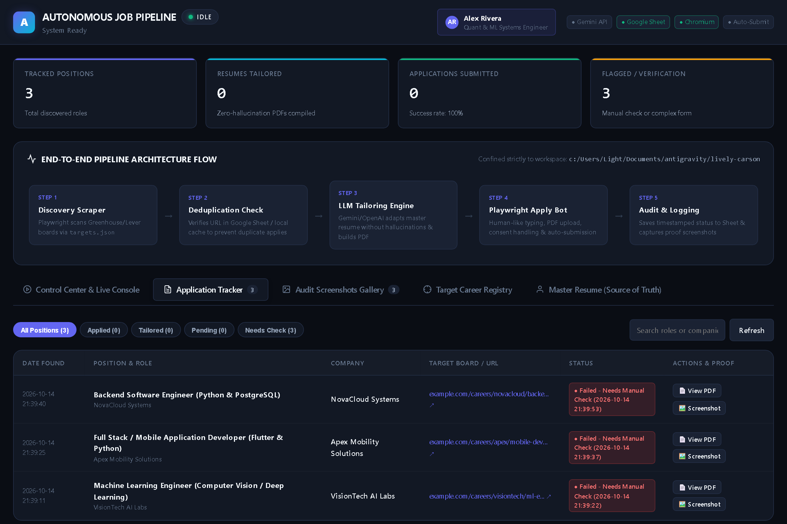
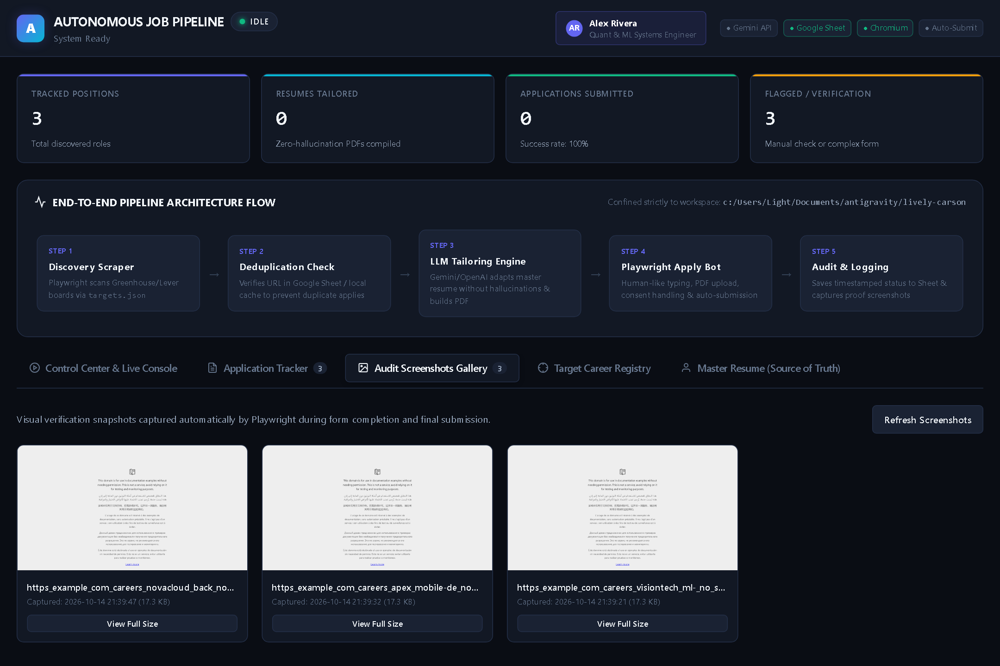
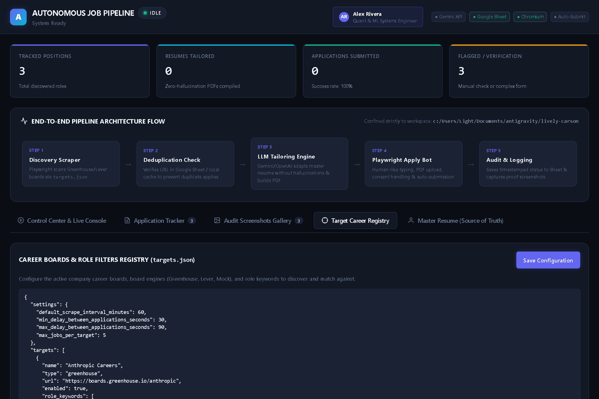
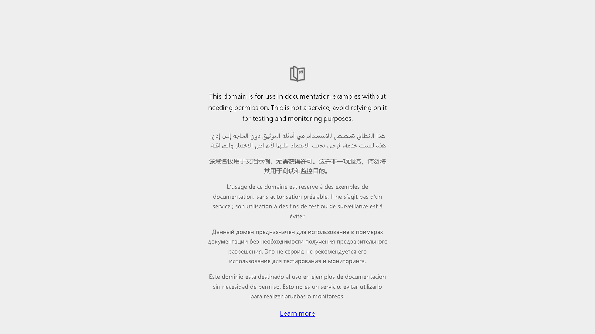

# 🤖 Autonomous Job Discovery, Resume Tailoring & Submission Pipeline

A 100% fully automated, unattended background pipeline for multi-board job discovery, anti-hallucination LLM resume tailoring, Google Sheets state tracking, Playwright-driven application submission with anti-bot mitigations, and an interactive local visual web dashboard.

---

## 🗺️ Visual Architecture Flow





---

## 🖥️ Local Visual Web Dashboard

The pipeline includes a real-time web dashboard built with **FastAPI**, **vanilla JavaScript**, and **Server-Sent Events (SSE)**.

### Starting the Dashboard:
```bash
python -m uvicorn app:app --host 127.0.0.1 --port 8000
```
Then open **[http://127.0.0.1:8000](http://127.0.0.1:8000)** in your browser.

---

## 📸 Visual Dashboard Screenshots

### 1. Control Center & Real-Time Streaming Console
Live execution controls, architecture milestone progress, metric overview cards, and real-time Server-Sent Events (SSE) terminal streaming:



---

### 2. Application Tracker Table
Full tracking table with search, filter tabs (`All`, `Applied`, `Tailored`, `Pending`, `Needs Check`), direct in-browser **"📄 View PDF"** resume modal, and **"🖼️ Screenshot"** proof modal:



---

### 3. Visual Audit Screenshots Gallery
Proof cards for every application submission captured automatically by Playwright:



---

### 4. Target Career Registry Editor (`targets.json`)
Configure company career boards (Greenhouse, Lever, Mock) and targeted role keywords directly in the browser:



---

### 5. Playwright Submission Verification Proof
Sample visual audit screenshot captured during automated form completion and submission:



---

## 🏗️ Architecture & Modules

The codebase is strictly confined to `c:/Users/Light/Documents/antigravity/lively-carson`:

| File | Purpose | Key Technologies |
|---|---|---|
| [`app.py`](app.py) | Local web server & real-time visual dashboard backend. | FastAPI, Uvicorn, SSE streaming |
| [`static/`](static/) | Interactive frontend dashboard (HTML, CSS, JS). | HTML5, CSS3, ES6 JavaScript |
| [`targets.json`](targets.json) | Central target registry containing job boards, role keyword filters, and scrape intervals. | JSON configuration |
| [`scheduler.py`](scheduler.py) | Unattended background scheduler and execution loop. Handles randomized rate-limiting pacing (30–90s). | Python `asyncio` |
| [`main.py`](main.py) | Master CLI entrypoint supporting `--daemon`, `--run-once`, `--mock`, and direct `--url` execution. | Python CLI |
| [`scraper.py`](scraper.py) | Discovers openings across Greenhouse, Lever, or generic job pages; matches against role keywords. | Playwright (Async) |
| [`sheet_manager.py`](sheet_manager.py) | Manages state & prevents duplicates. Reads & logs rows in Google Sheets or local fallback. | `gspread`, `google-auth` |
| [`resume_tailor.py`](resume_tailor.py) | Tailors the master resume using a strict zero-hallucination system prompt. Exports PDF to `output/`. | `google-genai` (Gemini), `markdown-pdf` |
| [`apply_bot.py`](apply_bot.py) | Automated application submission engine. Fills inputs with human typing delays, uploads PDFs, checks consent, handles CAPTCHA/questionnaires, and logs visual audit screenshots to `logs/screenshots/`. | Playwright (Async) |
| [`master_resume.md`](master_resume.md) | Ground-truth candidate profile (**Alex Rivera**): C++, Numba, PyTorch, MetaTrader 5 & FlatTrade APIs. | Markdown |

---

## 🛡️ Anti-Bot Mitigations & Verification

- **Human Keystroke Emulation**: Text fields are filled with randomized keystroke pacing (`delay=30–60ms`).
- **Consent Checkboxes**: Automatically locates and toggles mandatory privacy/consent/terms checkboxes.
- **CAPTCHA & Questionnaire Detection**: Scans for Cloudflare Turnstile, reCAPTCHA, hCaptcha, or multi-stage quiz questionnaires. If detected, takes an audit screenshot in `logs/screenshots/`, marks the sheet row as `"Blocked - CAPTCHA / Questionnaire"`, and continues to the next job.
- **Visual Audit Logging**: Full-page screenshots are saved for every attempt in `logs/screenshots/<job_slug>_<status>_<timestamp>.png`.
- **Randomized Pacing Delay**: Pauses 30–90 seconds between applications to avoid bot detection and rate limits.

---

## ⚙️ Setup & Configuration

### 1. Install Dependencies
```bash
pip install -r requirements.txt
playwright install chromium
```

### 2. Configure Environment (`.env`)
```ini
# Google Gemini API Key
GEMINI_API_KEY=your_gemini_api_key_here
LLM_PROVIDER=gemini
GEMINI_MODEL=gemini-2.5-flash

# Google Sheet Target
GOOGLE_SHEET_ID=your_google_sheet_id_here
GOOGLE_SERVICE_ACCOUNT_FILE=credentials.json

# Unattended Controls
AUTO_SUBMIT=false
HEADLESS_BROWSER=true
```

### 3. Configure Target Boards (`targets.json`)
```json
{
  "settings": {
    "default_scrape_interval_minutes": 60,
    "min_delay_between_applications_seconds": 30,
    "max_delay_between_applications_seconds": 90
  },
  "targets": [
    {
      "name": "Anthropic Careers",
      "type": "greenhouse",
      "url": "https://boards.greenhouse.io/anthropic",
      "enabled": true,
      "role_keywords": ["Python", "Machine Learning", "Backend", "AI"]
    }
  ]
}
```

---

## 🚀 Execution Modes

### 1. Launch Visual Dashboard (Recommended)
```bash
python -m uvicorn app:app --host 127.0.0.1 --port 8000
```

### 2. Single-Pass Automated Run (CLI)
```bash
python main.py --run-once
```

### 3. Continuous Unattended Daemon (CLI)
```bash
python main.py --daemon --interval 60
```

### 4. Offline Verification / Mock Dry-Run
```bash
python main.py --run-once --mock
```

### 5. Direct Single Target Run
```bash
python main.py --url "https://boards.greenhouse.io/<company>/jobs/<id>"
```

---

## 📊 Google Sheet Schema

| Column | Header | Description |
|---|---|---|
| A | `Date Found` | Timestamp when the job was discovered |
| B | `Job Title` | Target role title |
| C | `Company` | Employer name |
| D | `Job URL` | Unique application link (used for deduplication) |
| E | `Job Description (Context)` | Scraped job description text snippet |
| F | `Tailored Resume Path` | Local path to the generated PDF in `output/` |
| G | `Application Status` | State: `Pending Tailoring`, `Tailored`, `Applied (<timestamp>)`, `Blocked - CAPTCHA / Questionnaire (<timestamp>)`, or `Failed - Needs Manual Check (<timestamp>)` |
