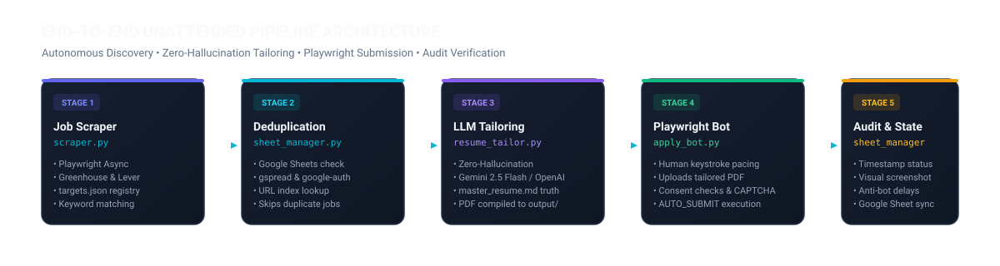
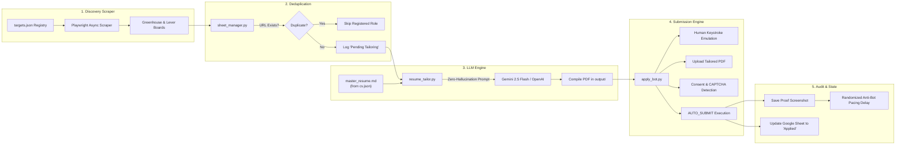
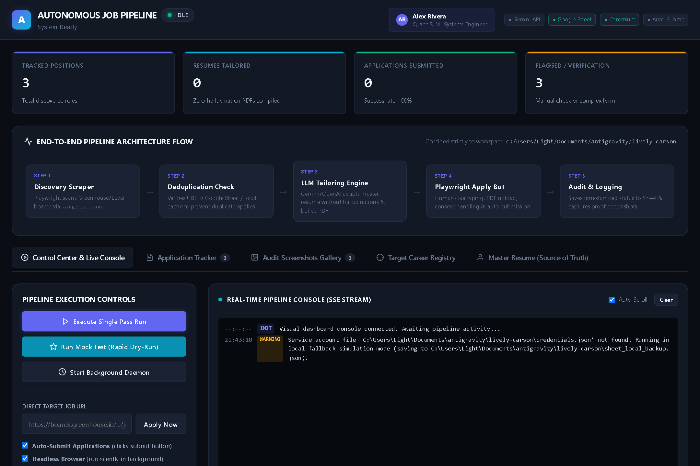
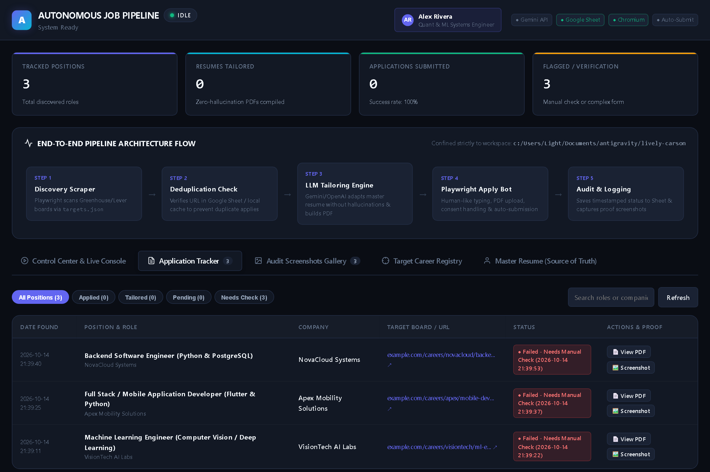
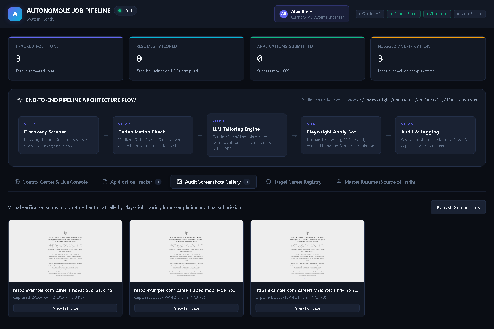
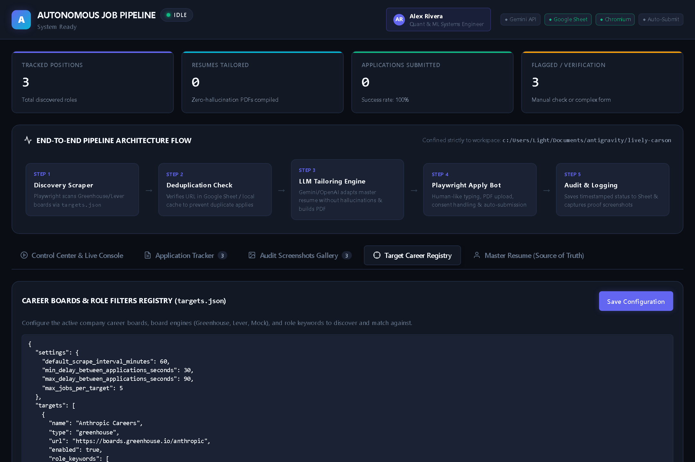
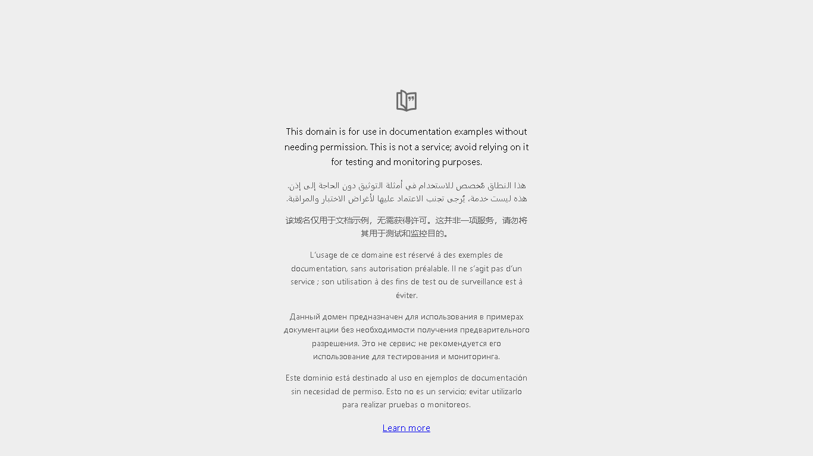

# 🤖 Autonomous Job Discovery, Resume Tailoring & Submission Pipeline

A 100% fully automated, unattended background pipeline for multi-board job discovery, anti-hallucination LLM resume tailoring, Google Sheets state tracking, Playwright-driven application submission with anti-bot mitigations, and an interactive local visual web dashboard.

---

## 🗺️ Visual Architecture Flow





---

## 🖥️ Local Visual Web Dashboard

The pipeline includes a real-time web dashboard built with **FastAPI**, **vanilla JavaScript**, and **Server-Sent Events (SSE)**.

### Starting the Dashboard:
```bash
python -m uvicorn app:app --host 127.0.0.1 --port 8000
```
Then open **[http://127.0.0.1:8000](http://127.0.0.1:8000)** in your browser.

---

## 📸 Visual Dashboard Screenshots

### 1. Control Center & Real-Time Streaming Console
Live execution controls, architecture milestone progress, metric overview cards, and real-time Server-Sent Events (SSE) terminal streaming:



---

### 2. Application Tracker Table
Full tracking table with search, filter tabs (`All`, `Applied`, `Tailored`, `Pending`, `Needs Check`), direct in-browser **"📄 View PDF"** resume modal, and **"🖼️ Screenshot"** proof modal:



---

### 3. Visual Audit Screenshots Gallery
Proof cards for every application submission captured automatically by Playwright:



---

### 4. Target Career Registry Editor (`targets.json`)
Configure company career boards (Greenhouse, Lever, Mock) and targeted role keywords directly in the browser:



---

### 5. Playwright Submission Verification Proof
Sample visual audit screenshot captured during automated form completion and submission:



---

## 🏗️ Architecture & Modules

The codebase is strictly confined to `c:/Users/Light/Documents/antigravity/lively-carson`:

| File | Purpose | Key Technologies |
|---|---|---|
| [`app.py`](app.py) | Local web server & real-time visual dashboard backend. | FastAPI, Uvicorn, SSE streaming |
| [`static/`](static/) | Interactive frontend dashboard (HTML, CSS, JS). | HTML5, CSS3, ES6 JavaScript |
| [`targets.json`](targets.json) | Central target registry containing job boards, role keyword filters, and scrape intervals. | JSON configuration |
| [`scheduler.py`](scheduler.py) | Unattended background scheduler and execution loop. Handles randomized rate-limiting pacing (30–90s). | Python `asyncio` |
| [`main.py`](main.py) | Master CLI entrypoint supporting `--daemon`, `--run-once`, `--mock`, and direct `--url` execution. | Python CLI |
| [`scraper.py`](scraper.py) | Discovers openings across Greenhouse, Lever, or generic job pages; matches against role keywords. | Playwright (Async) |
| [`sheet_manager.py`](sheet_manager.py) | Manages state & prevents duplicates. Reads & logs rows in Google Sheets or local fallback. | `gspread`, `google-auth` |
| [`resume_tailor.py`](resume_tailor.py) | Tailors the master resume using a strict zero-hallucination system prompt. Exports PDF to `output/`. | `google-genai` (Gemini), `markdown-pdf` |
| [`apply_bot.py`](apply_bot.py) | Automated application submission engine. Fills inputs with human typing delays, uploads PDFs, checks consent, handles CAPTCHA/questionnaires, and logs visual audit screenshots to `logs/screenshots/`. | Playwright (Async) |
| [`master_resume.md`](master_resume.md) | Ground-truth resume for LLM tailoring, generated from `cv.json` (Portfolio tab → Copy CV into Master Resume). | Markdown |
| [`cv.json`](cv.json) | Structured CV (profile, skills with levels, projects, experience, education) that drives the portfolio site and cold emails. | JSON |
| [`portfolio_builder.py`](portfolio_builder.py) | Builds the public portfolio site in `portfolio/` from `cv.json` and compiles the CV PDF it links and emails attach. | `markdown-pdf` |
| [`portfolio/`](portfolio/) | Static visual CV website: skill meters, skill → project filter, project cards, experience timeline. Published to its own public repo by [`publish_site.py`](publish_site.py). | HTML5, CSS3, ES6 JavaScript |
| [`cold_emailer.py`](cold_emailer.py) | Cold outreach engine: contacts, zero-hallucination email drafts, SMTP sending with CV attached, threaded follow-ups, reply detection, daily caps. | `smtplib`, `imaplib`, Gemini / OpenAI |
| [`research_copilot/`](research_copilot/) | RAG over project docs: redaction, heading-aware chunking, hybrid BM25 + embedding retrieval, local LLM answers, sentence grounding check, evaluation harness. | Ollama (Qwen2.5, nomic-embed-text), NumPy |

---

## 🛡️ Anti-Bot Mitigations & Verification

- **Human Keystroke Emulation**: Text fields are filled with randomized keystroke pacing (`delay=30–60ms`).
- **Consent Checkboxes**: Automatically locates and toggles mandatory privacy/consent/terms checkboxes.
- **CAPTCHA & Questionnaire Detection**: Scans for Cloudflare Turnstile, reCAPTCHA, hCaptcha, or multi-stage quiz questionnaires. If detected, takes an audit screenshot in `logs/screenshots/`, marks the sheet row as `"Blocked - CAPTCHA / Questionnaire"`, and continues to the next job.
- **Visual Audit Logging**: Full-page screenshots are saved for every attempt in `logs/screenshots/<job_slug>_<status>_<timestamp>.png`.
- **Randomized Pacing Delay**: Pauses 30–90 seconds between applications to avoid bot detection and rate limits.

---

## 🌐 Portfolio Website (Visual CV)

`cv.json` is the structured source of truth for your public CV. Edit it in the dashboard (**Portfolio & CV Website** tab) or by hand, then rebuild:

```bash
python portfolio_builder.py
```

This writes `portfolio/cv.json`, compiles `portfolio/resume.pdf`, and stamps the page title and link-preview tags. Every project with a `slug` also gets a case-study page (`project.html?p=<slug>`) built from its `overview`, `gallery` (images in `portfolio/assets/projects/<slug>/`), `architecture` (drawn as a flow or layer diagram), `decisions` and `results`. Optional extras: `diagrams` (more flow/layer charts per project), `proof` (measured commits, lines of code, test files and an evidence list) and a top-level `system_map` that draws how the projects connect on the home page. Preview locally at **[http://127.0.0.1:8000/portfolio/](http://127.0.0.1:8000/portfolio/)** while the dashboard runs.

**Publishing:** this repository is private; recruiters only see the site and the CV. [`publish_site.py`](publish_site.py) mirrors the built `portfolio/` folder into the public `PrivateRaj18110.github.io` repository (cloned into the gitignored `site_repo/`), and GitHub Pages serves it at https://privateraj18110.github.io/. Run `python portfolio_builder.py --sync-master --publish` after changing `cv.json`. `profile.links.portfolio` holds the live URL so the CV and cold emails link to it. The phone number stays off the public site unless `profile.show_phone` is `true`.

---

## ✉️ Cold Email Outreach

Add recruiters / hiring managers in the **Cold Outreach** tab (form or CSV with `name, email, company, role, job_url, notes`). Each outreach cycle:

1. Checks your inbox over IMAP and marks anyone who replied as **Replied** (no more emails to them).
2. Drafts a personal email for each new contact from `cv.json`, using the linked job's description when there is one. The LLM may only cite facts from your CV; with no API key a template is used.
3. With auto-send on, sends first emails (CV PDF attached, the tailored resume when the contact is linked to a tracked job) and one threaded follow-up after `EMAIL_FOLLOWUP_DAYS`.

Guardrails: `EMAIL_DAILY_LIMIT` per day, 60–180s random pacing, one first email per address, `EMAIL_MAX_FOLLOWUPS` follow-ups, a **Do not contact** status, and an opt-out line in every email.

**Going live:** keep `EMAIL_DRY_RUN=true` first and read the previews in `output/emails/`. Then add a Gmail [App Password](https://myaccount.google.com/apppasswords) as `SMTP_APP_PASSWORD`, set `EMAIL_DRY_RUN=false`, and restart the dashboard.

```bash
python cold_emailer.py --import contacts.csv
python cold_emailer.py --run-once            # drafts; sends too if EMAIL_AUTO_SEND=true
python cold_emailer.py --daemon --interval 60
python test_outreach.py                      # offline tests, never sends mail
```

---

## 📄 ATS Resume Benchmark

[`ats_benchmark.py`](ats_benchmark.py) collects real postings for the target roles from companies' public job-board feeds (Greenhouse, Lever, Ashby, and SmartRecruiters filtered to India), then reads a resume PDF the way an ATS parser does and scores it against every posting.

- **Parsing checks:** pages, ligature glyphs that split words ("verification"), email / phone / visible URLs in the header, standard section headings, images and tables.
- **Keyword match:** about 80 skills with synonyms ("Google Cloud" counts as GCP); for each posting, the share of the skills it asks for that the resume names. Skills are only added to `cv.json` when the projects show them.
- `resume.pdf` is rendered from `cv.json`'s `resume` section in Segoe UI, which has no ligature glyphs, with the addresses as visible link text.

```bash
python ats_benchmark.py collect                       # postings -> output/ats/postings.jsonl
python ats_benchmark.py score portfolio/resume.pdf    # report -> output/ats/report_resume.md
```

---

## 🔎 Research Copilot (RAG + open-source LLM)

Retrieval-augmented generation over your own project docs, answered by an open-source model running locally through [Ollama](https://ollama.com). Nothing leaves the machine. Ask questions in the **Research Copilot (RAG)** tab or from the CLI.

1. **Ingest:** markdown files listed in `copilot_sources.json` (copy `copilot_sources.example.json`). `.env` files, anything named secret/credential, agent memory files and `.git` are always skipped.
2. **Redact & chunk:** API keys, passwords, tokens and long hex digests are replaced with `[redacted]`; docs are split at headings into ~1,200-character chunks that keep their heading path.
3. **Embed:** `nomic-embed-text` vectors, checkpointed per chunk so an interrupted build resumes where it stopped.
4. **Retrieve:** BM25 and cosine similarity each rank 30 candidates; reciprocal rank fusion keeps the top 5.
5. **Answer:** `qwen2.5:1.5b` answers only from those passages, or replies "The documents do not cover this."
6. **Ground:** each answer sentence is cited to the passage that shares most of its words; sentences no passage supports are flagged.

On 299 docs (5,126 chunks) and 12 labelled questions: retrieval hit@5 100%, MRR 0.708; 64% of expected facts present; on average 92% of an answer's sentences grounded; 2/2 out-of-scope questions refused; median 38.5 s per answer on an Intel N95 CPU. Per-question scores are in [`research_copilot/eval_summary.json`](research_copilot/eval_summary.json); the full answers stay local in `copilot_index/eval_report.json` because they quote private docs.

```bash
ollama pull qwen2.5:1.5b && ollama pull nomic-embed-text
python -m research_copilot build             # index the sources (resumable)
python -m research_copilot ask "Why can LLS not route real-money orders?"
python -m research_copilot eval              # retrieval + answer quality report
python test_copilot.py                       # offline tests with a fake LLM
```

---

## ⚙️ Setup & Configuration

### 1. Install Dependencies
```bash
pip install -r requirements.txt
playwright install chromium
```

### 2. Configure Environment (`.env`)
```ini
# Google Gemini API Key
GEMINI_API_KEY=your_gemini_api_key_here
LLM_PROVIDER=gemini
GEMINI_MODEL=gemini-2.5-flash

# Google Sheet Target
GOOGLE_SHEET_ID=your_google_sheet_id_here
GOOGLE_SERVICE_ACCOUNT_FILE=credentials.json

# Unattended Controls
AUTO_SUBMIT=false
HEADLESS_BROWSER=true
```

### 3. Configure Target Boards (`targets.json`)
```json
{
  "settings": {
    "default_scrape_interval_minutes": 60,
    "min_delay_between_applications_seconds": 30,
    "max_delay_between_applications_seconds": 90
  },
  "targets": [
    {
      "name": "Anthropic Careers",
      "type": "greenhouse",
      "url": "https://boards.greenhouse.io/anthropic",
      "enabled": true,
      "role_keywords": ["Python", "Machine Learning", "Backend", "AI"]
    }
  ]
}
```

---

## 🚀 Execution Modes

### 1. Launch Visual Dashboard (Recommended)
```bash
python -m uvicorn app:app --host 127.0.0.1 --port 8000
```

### 2. Single-Pass Automated Run (CLI)
```bash
python main.py --run-once
```

### 3. Continuous Unattended Daemon (CLI)
```bash
python main.py --daemon --interval 60
```

### 4. Offline Verification / Mock Dry-Run
```bash
python main.py --run-once --mock
```

### 5. Direct Single Target Run
```bash
python main.py --url "https://boards.greenhouse.io/<company>/jobs/<id>"
```

---

## 📊 Google Sheet Schema

| Column | Header | Description |
|---|---|---|
| A | `Date Found` | Timestamp when the job was discovered |
| B | `Job Title` | Target role title |
| C | `Company` | Employer name |
| D | `Job URL` | Unique application link (used for deduplication) |
| E | `Job Description (Context)` | Scraped job description text snippet |
| F | `Tailored Resume Path` | Local path to the generated PDF in `output/` |
| G | `Application Status` | State: `Pending Tailoring`, `Tailored`, `Applied (<timestamp>)`, `Blocked - CAPTCHA / Questionnaire (<timestamp>)`, or `Failed - Needs Manual Check (<timestamp>)` |
